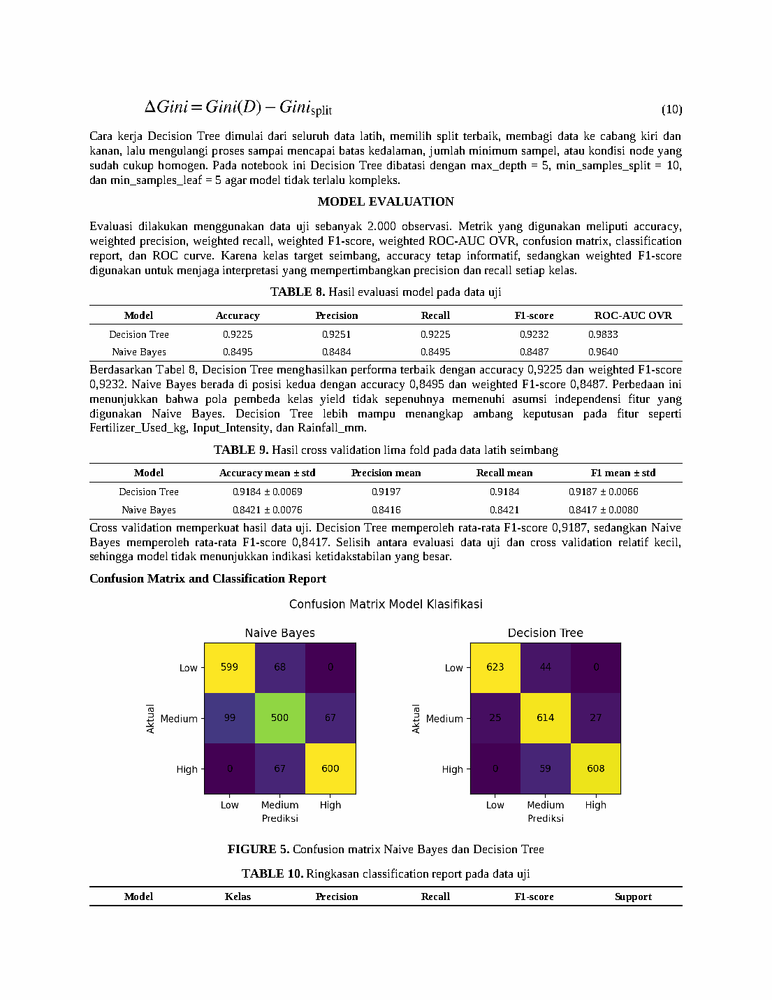

# Klasifikasi tingkat produktivitas panen

Proyek kelompok Data Mining mengubah target numerik `Yield_ton_per_ha` menjadi tiga kelas relatif, Low, Medium, dan High. Gaussian Naive Bayes dan Decision Tree dibandingkan pada 10.000 rekaman Smart Crop Yield Prediction Dataset.

## Data dan metode

Data memiliki 12 prediktor awal dan satu target numerik. Dua fitur kategorikal yang kosong diisi dengan `Unknown`: Irrigation sebanyak 2.538 baris dan Previous_Crop sebanyak 2.031 baris. Notebook memakai label encoding untuk fitur kategorikal, lalu membentuk empat fitur turunan: Rainfall_per_Temperature, Fertilizer_per_Density, Humidity_Temperature_Index, dan Input_Intensity.

Target dibagi menggunakan `qcut` pada seluruh dataset. Ambang historis sekitar 96,72 dan 139,07 ton/ha, sehingga kelas bergantung pada distribusi dataset. Data dibagi terstratifikasi menjadi 8.000 latih dan 2.000 uji. SMOTE diterapkan pada bagian latih, menghasilkan 8.001 baris. Mutual Information memilih 10 dari 16 prediktor. Chi-Square, ANOVA, dan tree importance menjadi pembanding.

Decision Tree memakai Gini impurity, `max_depth=5`, `min_samples_split=10`, `min_samples_leaf=5`, dan `class_weight="balanced"`. Seed utama adalah 42.

## Hasil yang tercatat

| Model | Accuracy | Weighted F1 | Weighted ROC-AUC OVR |
| --- | ---: | ---: | ---: |
| Gaussian Naive Bayes | 84,95% | 0,8487 | 0,9640 |
| Decision Tree | 92,25% | 0,9232 | 0,9833 |

Sumber: [notebook asli](notebooks/original.ipynb), output sel 47, dan [laporan](evidence/laporan.pdf), Tabel 8 halaman 8. Angka merupakan hasil historis pada 2.000 data uji. Training belum dijalankan ulang dalam pemeriksaan ini.

Visualisasi feature importance dan pohon keputusan tersedia pada [halaman 11 laporan](evidence/laporan-page-11.png). Feature importance menjelaskan kontribusi dalam model; hubungan sebab akibat belum diuji.

## Menjalankan notebook asli

1. Pasang dependensi dari `requirements.txt` pada environment Jupyter/Colab. Versi paket historis lengkap belum tersedia.
2. Buka `notebooks/original.ipynb`. Pada sel 7, tetapkan `DATA_PATH = "../data/crop_yield_dataset.csv"` apabila direktori kerja kernel adalah `notebooks/`. Sesuaikan path apabila membuka notebook dari direktori lain.
3. Jalankan dari sel awal sampai akhir. Periksa bentuk dataset, batas kuantil, hasil split, jumlah baris setelah SMOTE, dan daftar fitur terpilih.
4. Catat hasil baru secara terpisah. Notebook menyimpan paket model menggunakan joblib sesuai `MODEL_OUTPUT_PATH` pada konfigurasi.

Notebook dipertahankan sebagai bukti historis. Langkah menjalankannya membantu mereplikasi implementasi lama, sementara perbaikan validasinya belum diterapkan.

## Temuan audit

Sel 30 menerapkan SMOTE pada seluruh bagian latih; sel 33 kemudian melakukan seleksi fitur pada bagian latih yang sudah diseimbangkan. Sel 44 menjalankan cross-validation atas hasil kedua tahap tersebut. Dengan demikian, resampling dan seleksi fitur berlangsung sebelum pembagian fold. Skor CV historis belum layak dipakai sebagai bukti validasi independen. Keduanya perlu dipasang dalam pipeline yang dilatih ulang pada setiap fold. Pola ini dibahas dalam [dokumentasi imbalanced-learn](https://imbalanced-learn.org/stable/common_pitfalls.html).

Label encoding dan kuantil juga dipelajari sebelum split. Definisi label kuantil pada seluruh dataset perlu dinyatakan secara terbuka dan dibandingkan dengan ambang yang ditetapkan dari bagian latih atau standar domain. Distribusi kelas latih 2.666/2.667/2.667 nyaris seimbang; SMOTE hanya menambah satu baris, sehingga manfaatnya belum terbukti. Interpolasi kode kategori nominal perlu ditinjau apabila resampling tetap digunakan.

Pengujian pada data pertanian independen belum tersedia. Kelas Low/Medium/High merupakan kategori relatif dataset, dan performa ini belum menunjukkan kegunaan operasional di lapangan.

Penulis laporan: Naufal Zainul Zaki, Ika Kurniati, dan Sabian Franstiawan. Kontribusi pribadi Naufal belum dikonfirmasi.
